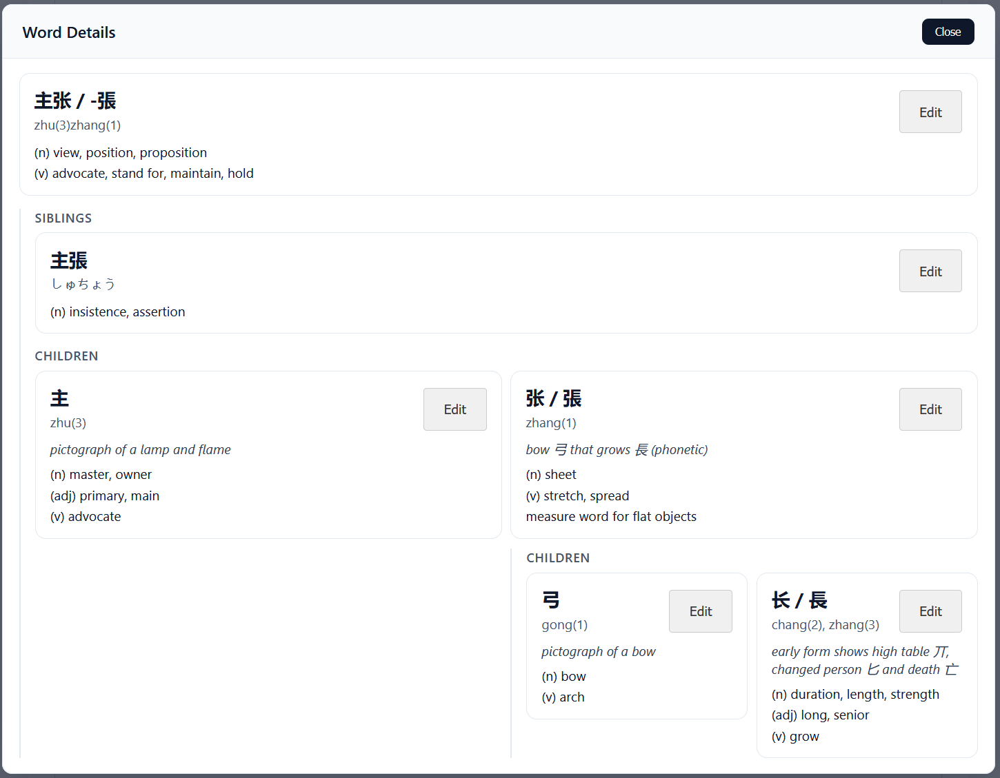

# Mandarinko Monorepo

Mandarinko is a TypeScript monorepo with three packages:

- `@mandarinko/core` — shared vocabulary management, validation, and types
- `@mandarinko/server` — Express REST API
- `@mandarinko/teacher-app` — React teacher app

This README is the authoritative guide for building and running the monorepo.

**Reusable UI Examples**

- [CRT terminal banner](packages/teacher-app/README.md#reusable-crt-treatment):
  portable CSS, plain HTML and React usage, themes, and a runnable example.

**Word Traversal Modal Screenshots**




## Vocabulary data sources

Japanese vocabulary and community JLPT study levels use a pinned
[OpenJLPT](https://github.com/evanclan/OpenJLPT) snapshot, derived from Jonathan
Waller’s lists and JMdict (EDRDG). The selected N5 and N4 lists are disjoint;
levels are unofficial study classifications, not an exhaustive exam syllabus.
Readings belong to actual Japanese words. Common kana headwords remain primary;
reviewed kanji spellings are alternatives, not guesses from character readings.

Japanese words reuse Chinese character trees. Whole-word siblings connect shared
character spellings, with explicit Japanese old/new character correspondences;
they do not imply equivalent meanings. Distinct histories such as Japanese 机
(“desk”) and simplified Chinese 机 for 機 (“machine”) remain separate. New research
adds to existing entries and relationships without replacing their IDs or trees.

Additional character explanations use
[Make Me a Hanzi](https://github.com/skishore/makemeahanzi)’s `dictionary.txt`
(Unihan/CJKlib-derived, LGPL-3.0-or-later), supplemented by short Wiktionary
excerpts. Source glyph explanations are retained; entries labelled “Written
structure” describe their shape without claiming an established historical origin.
Unknown portions of an ideographic description sequence use `？`. Chinese readings
use tone marks; umlauts are omitted according to this dictionary’s convention.

[Field provenance](packages/server/vocabulary.sources.json) identifies source
revisions, entry IDs and adapted fields. The OpenJLPT-derived data and Wiktionary
adaptations are CC BY-SA 4.0; Make Me a Hanzi-derived character data retains its
LGPL-3.0-or-later terms. Source notices and license texts are in
[server licenses](packages/server/licenses). These data terms are separate from
the application code license. Existing dictionary material retains its provenance.

**WSL Development Setup**

Use the native Linux checkout at `~/gits/Mandarinko`, with Linux Node.js and pnpm.
Open it from a WSL terminal with `code .` to use VS Code's WSL integration.
The Windows checkout is a separate copy; changes and vocabulary edits do not sync
between the two locations.

Use the Node version in [.nvmrc](.nvmrc) and pnpm version in
[package.json](package.json). With nvm installed, run from the repository root:

```bash
nvm install
nvm use
corepack enable
pnpm install --frozen-lockfile
```

Run `nvm use` in each terminal. Reinstall dependencies inside WSL rather than
copying `node_modules` from Windows or a container. The pnpm workspace and
`pnpm-lock.yaml` own dependency installation; use pnpm for dependency changes.

**Build**

```bash
pnpm build
```

**Verification**

Run lint, typechecking, all package tests, and the production build:

```bash
pnpm check
```

Run tests alone:

```bash
pnpm test
```

Browser behavior tests use isolated temporary vocabulary files and their own
frontend on port 3014. They never write to the development vocabulary:

```bash
pnpm exec playwright install chromium
pnpm test:browser
```

Failure traces and screenshots are generated under `test-results/`.

`pnpm format:check` checks formatting separately. Existing source and vocabulary
formatting differences remain; the functional check does not enforce formatting.

**Run (Development)**

Start the core watcher, API, and teacher app together:

```bash
pnpm dev
```

This builds core before starting the watchers. Open `http://localhost:3001`;
the API listens on `http://localhost:3000`. Vite uses native filesystem watching
on the Linux checkout.

Server (API):

```bash
pnpm --filter @mandarinko/server run dev
```

Teacher app (Vite dev server):

```bash
pnpm --filter @mandarinko/teacher-app run dev
```

The server reads and writes `packages/server/vocabulary.json` when launched with
these workspace commands. Keep local vocabulary changes when updating the repo.
Development commands above target native WSL; the older devcontainer configuration
has not been validated with the pinned runtime.

**Type Safety and No-Duplication Architecture**

Type safety is enforced across packages by sharing types and validation from a single source of truth:

- `@mandarinko/core` exports vocabulary types (`Word`, `Spelling`, `WordMetadata`, `LanguageCode`) and shared validation via `ValidationService`.
- `@mandarinko/server` consumes core types and exposes its own API request/response types for frontend usage.
- `@mandarinko/teacher-app` imports core types and validation, and uses server API types to keep client/server contracts aligned.

Duplication is avoided by pushing common logic into `@mandarinko/core` and reusing it in both the server and the teacher app:

- Vocabulary rules and validation live in core only.
- Server routes operate on core types and call core validation.
- The teacher app never redefines vocabulary shapes or validation rules.

**Manage Dependencies**

Install all workspace dependencies:

```bash
pnpm install
```

Add a dependency to a specific package:

```bash
pnpm add <package> --filter @mandarinko/server
pnpm add <package> --filter @mandarinko/teacher-app
pnpm add <package> --filter @mandarinko/core
```

Add a dev dependency to a specific package:

```bash
pnpm add -D <package> --filter @mandarinko/server
```

Add a root-level tooling dependency (for shared tooling like ESLint or Prettier):

```bash
pnpm add -D <package> -w
```

Use workspace packages as dependencies:

```bash
pnpm add @mandarinko/core --filter @mandarinko/teacher-app
pnpm add @mandarinko/server --filter @mandarinko/teacher-app
```

**Workspace Structure**

```
packages/
  core/
  server/
  teacher-app/
```

For package-specific details, see:

- `packages/core/README.md`
- `packages/server/README.md`
- `packages/teacher-app/README.md`
