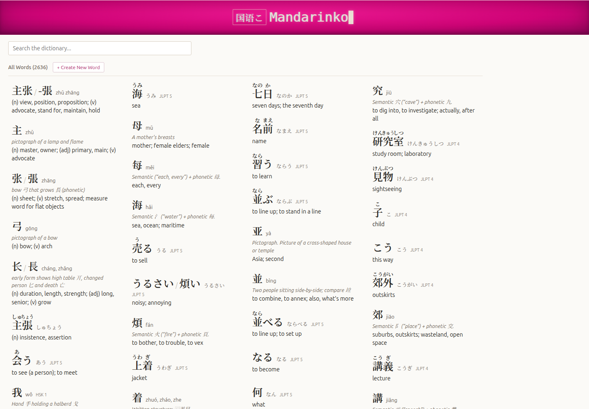
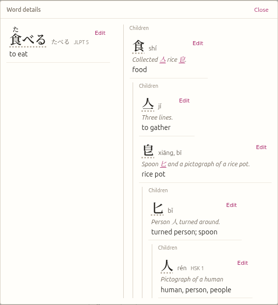
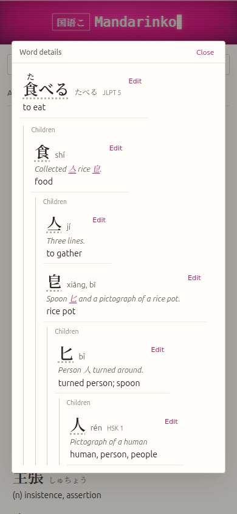
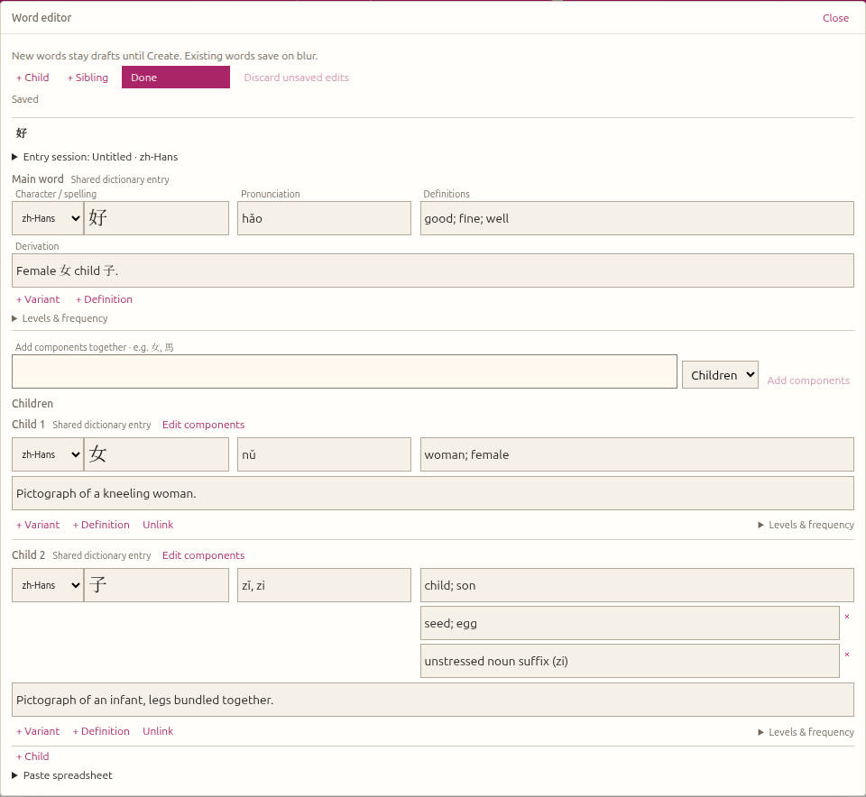
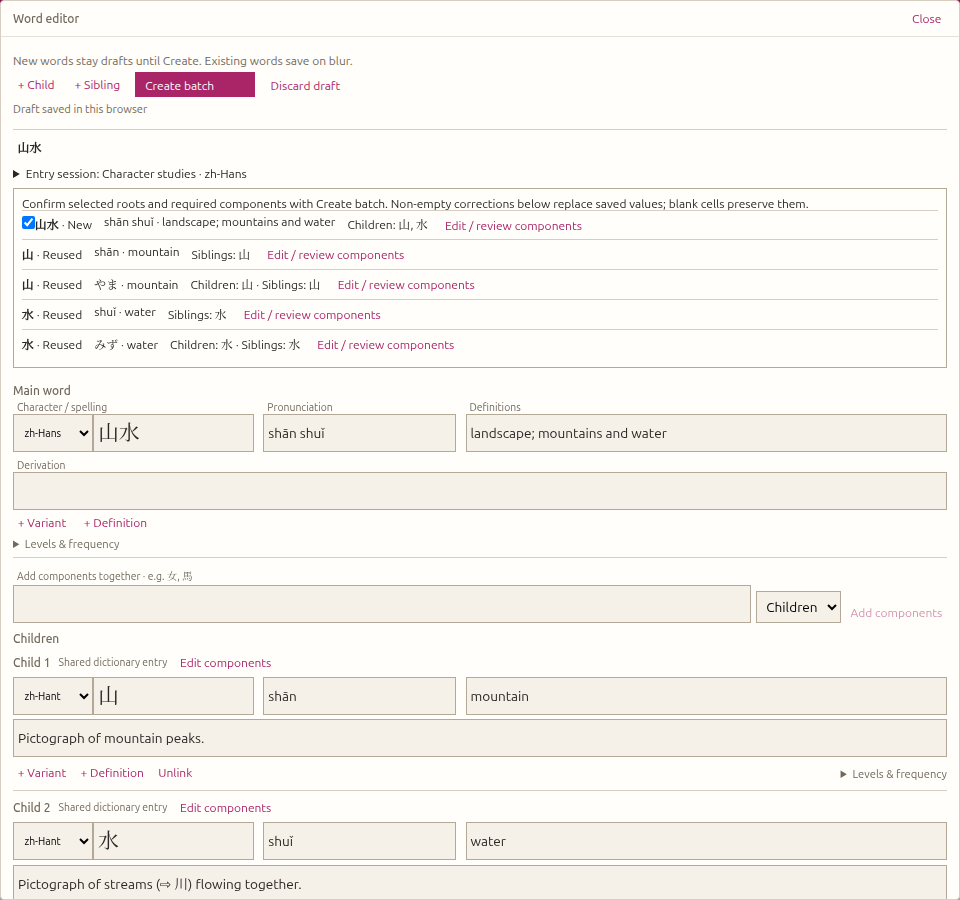

# Mandarinko

A Chinese and Japanese dictionary and grammar authoring application.
Follow a word into its components, connect Japanese kanji to their Chinese
character histories, and reuse those explanations when authoring new entries.



## Explore words through their characters

Entries keep spellings, pronunciation, derivation and definitions together in a
compact dictionary layout. Simplified and traditional Chinese variants share an
entry; Japanese words keep their own kana reading and meaning. HSK and JLPT labels
identify study levels.

Open a word to explore its component tree. Characters in derivation text link to
other entries, and browser Back and Forward let you follow a trail through the
same details modal. Japanese vocabulary reuses the Chinese character trees: in
**食べる → 食**, the Japanese word retains **たべる**, while 食 and its components
show their Chinese pronunciations and explanations. Sibling links connect words
through shared character use, even when their meanings differ.




Click a spelling in Word details to loop its stroke order; click again to return
to text. The spelling keeps its dimensions while switching. Japanese spellings
also use Furifont’s built-in furigana. These automatic readings can be inaccurate;
the separate pronunciation field is canonical. Stroke data loads on demand and
requires a network connection on first use; unavailable data leaves the text
visible. Some rare component glyphs depend on the fonts installed on your device.

The terminal banner has a typing wordmark, blinking cursor and CRT effects, with
a static presentation for reduced-motion preferences. Its
[standalone CSS and reusable HTML/React examples](packages/teacher-app/README.md#reusable-crt-treatment)
can be used in other applications.

## Author and reuse vocabulary

**Edit** opens the word editor, where spelling, pronunciation, definitions and
derivation are directly editable. Text fields grow with their contents. Valid
edits to saved entries autosave on blur; new words remain drafts until an explicit
**Create** action. **Close** retains unfinished work in the current browser.

Autocomplete reuses existing entries and their complete trees. Add several
components together, then use **Edit components** and breadcrumbs to fill missing
descendants inside the same modal. Shared-entry indicators make it clear when an
edit affects a word used elsewhere. Entry sessions retain language and optional
HSK/JLPT defaults between new words.



For researched batches, paste a header-based TSV spreadsheet and review new,
reused and updated entries before **Create batch**. Non-empty supplied fields
replace saved values after confirmation; blank cells preserve them, and supplied
relationships are additive. Interrupted saves retain acknowledged writes and
unfinished work for explicit retry; publication is not a transaction.



See the [teacher-app README](packages/teacher-app/README.md#word-editor) for editor
controls, keyboard shortcuts, draft recovery and the clipboard format. Agent
entry procedures live in [the teacher-app AGENTS.md](packages/teacher-app/AGENTS.md).

## Vocabulary and sources

The dictionary includes the classic 150-word HSK1 set and the selected JLPT N5
and N4 study lists, alongside shared Chinese character components. Japanese
entries represent actual words with specific readings, rather than inventories
of every possible kanji reading. Higher-level research can enrich a shared
character tree without replacing the entries that already use it.

Japanese vocabulary and JLPT classifications use a pinned
[OpenJLPT](https://github.com/evanclan/OpenJLPT) snapshot, derived from Jonathan
Waller’s lists and JMdict (EDRDG). N5 and N4 are disjoint study lists; the levels
are unofficial approximations, not an exhaustive exam syllabus. Common kana
headwords remain primary, with reviewed kanji spellings as alternatives.

Whole-word siblings connect shared character spellings, using explicit Japanese
old/new character correspondences; they do not imply equivalent meanings.
Distinct histories such as Japanese 机 (“desk”) and simplified Chinese 机 for
機 (“machine”) remain separate.

Character explanations draw on Zhongwen.com,
[Make Me a Hanzi](https://github.com/skishore/makemeahanzi)’s `dictionary.txt`
(Unihan/CJKlib-derived), and supplementary Wiktionary entries. Entries labelled
“Written structure” describe a shape without claiming an established historical
origin; `？` marks an unknown portion of a structural description. Chinese
pronunciations use tone marks, with umlauts omitted by this dictionary’s convention.

[Field provenance](packages/server/vocabulary.sources.json) records source
revisions, entry IDs and adapted fields for the JLPT imports and their character
research. OpenJLPT-derived data and Wiktionary adaptations are CC BY-SA 4.0;
Make Me a Hanzi-derived character data retains its LGPL-3.0-or-later terms.
[Source notices and license texts](packages/server/licenses) accompany the data.
These terms are separate from the application’s GPL-3.0 code license; existing
dictionary material retains its provenance.

## Explore and author grammar

Use **Dictionary** (`/`) and **Grammar** (`/grammar`) to switch between the two
pages. Grammar patterns use the same compact entry presentation, language-tagged
spellings and study metadata as words. Both pages search all entry fields,
including examples, categories, derivations and metadata where present.

Open a pattern for its definitions, translated examples and contrast links, then
choose **Edit**. Existing patterns autosave valid edits on blur; **Create New
Grammar Pattern** keeps a local draft until **Create**. Close retains unfinished
input in the current browser. Failed saves require explicit **Retry save**;
unconfirmed creations retain their original payload and request key across reload.
Patterns and examples are flat entries, without word component trees.

The grammar page reads and writes
[`packages/server/grammar.json`](packages/server/grammar.json), preserving its
versioned pattern array independently of vocabulary.

Switch **Grid / Graph** to explore the grammar concept map
(`/grammar?view=graph`). Nodes open the same pattern details; connections open
their types, direction and optional rationale. Mandarinko owns these judgments.
Each conceptual relationship contributes equally to node size and layout;
introduction order is an optional overlay and does not affect layout or prescribe
a lesson plan. The overview draws a subset of connections; **Show all connections**
reveals the complete filtered network. **Fit map** frames connected concepts;
**Fit all patterns** includes unlinked entries.

Connections live separately in
[`grammar.relationships.json`](packages/server/grammar.relationships.json).
See the [server connection API](packages/server/README.md#grammar-connections)
for the schema and comparison editing contract.

## Run locally

Use the native WSL checkout at `~/gits/Mandarinko` with Linux Node.js and pnpm.
The older Windows checkout is a separate copy; code and vocabulary edits do not
sync between them. Open the Linux checkout with `code .` for VS Code’s WSL
integration. The older devcontainer setup has not been validated with the pinned
runtime.

From the repository root, use the Node version in [.nvmrc](.nvmrc) and pnpm version
in [package.json](package.json):

```bash
nvm install
nvm use
corepack enable
pnpm install --frozen-lockfile
pnpm dev
```

Open **http://localhost:3001**. The API listens on **http://localhost:3000**.
`pnpm dev` builds core before starting the core, API and frontend watchers.
Run `nvm use` in each new terminal; install dependencies inside WSL rather than
copying `node_modules` from Windows.

The API reads and writes
[`packages/server/vocabulary.json`](packages/server/vocabulary.json) and
[`packages/server/grammar.json`](packages/server/grammar.json). Preserve local
catalog edits when updating the checkout. Unfinished editor work is stored in
the browser for that origin; it does not sync between browsers or machines.

To run packages separately after building core:

```bash
pnpm --filter @mandarinko/core build
pnpm --filter @mandarinko/server dev
# In another terminal:
pnpm --filter @mandarinko/teacher-app dev
```

## Develop and verify

| Command             | Purpose                                                         |
| ------------------- | --------------------------------------------------------------- |
| `pnpm check`        | Lint, production builds, typechecking and package tests.        |
| `pnpm test`         | Package tests without the full build/lint sequence.             |
| `pnpm test:browser` | Playwright interaction tests with isolated vocabulary fixtures. |
| `pnpm format:check` | Check formatting separately; existing formatting debt remains.  |
| `pnpm build`        | Build all workspace packages.                                   |

Install the pinned browser once before running browser tests:

```bash
pnpm exec playwright install chromium
pnpm test:browser
```

The browser harness starts its own frontend on port 3014 and an API backed by
per-test temporary vocabulary and grammar files. It does not require the development
server and never writes to live catalogs. Failure traces, screenshots and results are
written to `test-results/`.

The TypeScript/pnpm monorepo has three owning packages:

| Package                                       | Responsibility                                                 |
| --------------------------------------------- | -------------------------------------------------------------- |
| [core](packages/core/README.md)               | Shared entry types, search, validation and word relationships. |
| [server](packages/server/README.md)           | Express API contracts and JSON persistence.                    |
| [teacher-app](packages/teacher-app/README.md) | Dictionary and grammar pages, details and authoring.           |

The server and teacher app consume core’s public types and validation; the teacher
app also consumes the server’s API types. Editor domain controllers own draft
lifecycle, graph identity and publication. Components render their state and
dispatch user intent.

Use pnpm workspace filters when adding dependencies, and keep `pnpm-lock.yaml`
current:

```bash
pnpm add <package> --filter @mandarinko/teacher-app
pnpm add -D <package> --filter @mandarinko/server
pnpm add -D <package> -w
```

Read [AGENTS.md](AGENTS.md) before changing code, and the nested teacher-app guide
before authoring vocabulary or changing editor behavior.
